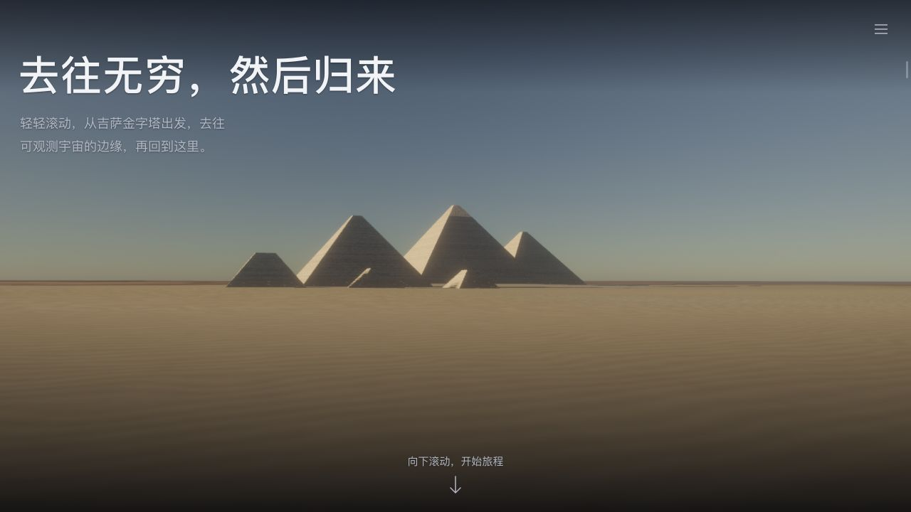
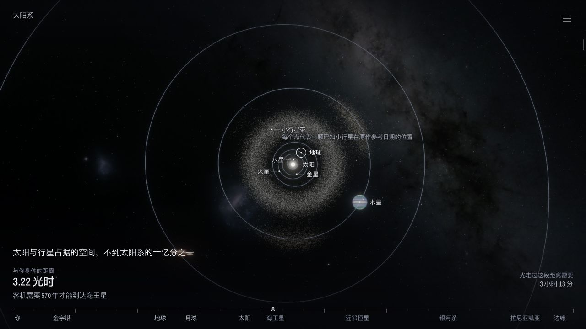

# 去往无穷，然后归来 · 中文致敬版

从吉萨金字塔出发，穿过太阳系与银河，抵达可观测宇宙的边缘，再回到这里。

原作：[Travel to infinity and back](https://vatsaltanna.com/traveltoinfinity/)，作者 [Vatsal Tanna](https://vatsaltanna.com/)。本项目是非官方、非商业的中文致敬与学习版本。

## 我们做了什么

- 中文化叙事、天体标签、距离刻度与界面。
- 自动播放、暂停续播，支持 0.25×–8× 共十档速度。
- 播放控件收起于屏幕右侧，悬停展开。
- 使用本地 VoiceStudio / OmniVoice 生成 72 段女声旁白，与字幕同步；读完当前句再推进，保持自然语速。

## 截图




## 本地运行

在项目目录执行（Python 3，无需安装依赖）：

```sh
python3 scripts/serve.py
```

打开 [http://127.0.0.1:4399/](http://127.0.0.1:4399/)，将鼠标移到右侧边缘开始播放。macOS 也可双击 `启动中文旅程.command`。使用支持 WebGL 2 的现代浏览器，通过 HTTP 打开页面。

网站及旁白已保存在 `dist/`，播放时无需启动 VoiceStudio。翻译与播放器可直接修改；构建和旁白生成见[开发说明](docs/development.md)。

## 来源与署名

原作的视觉、三维场景、程序与数据归原作者及各素材权利人所有，保留[原站素材署名与第三方许可](dist/licences.txt)。`original/` 是原站快照，并非作者的开发源码。尚未确认整站开放许可，本项目未为整站附加开源许可证。

## 演示分享

效果演示与分享，可在**微信公众号或小红书搜索「知之为知之知」**查看。
